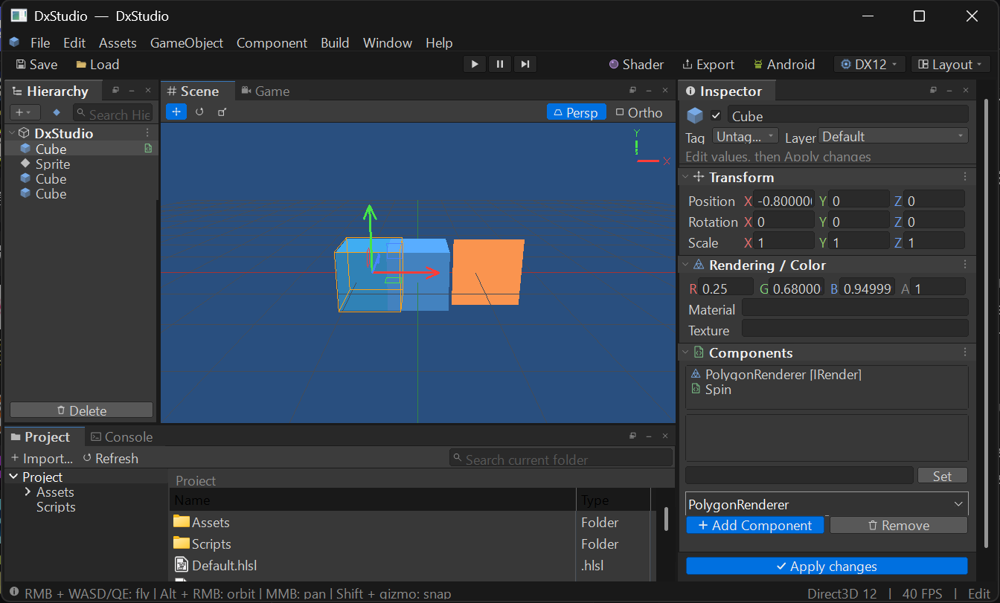
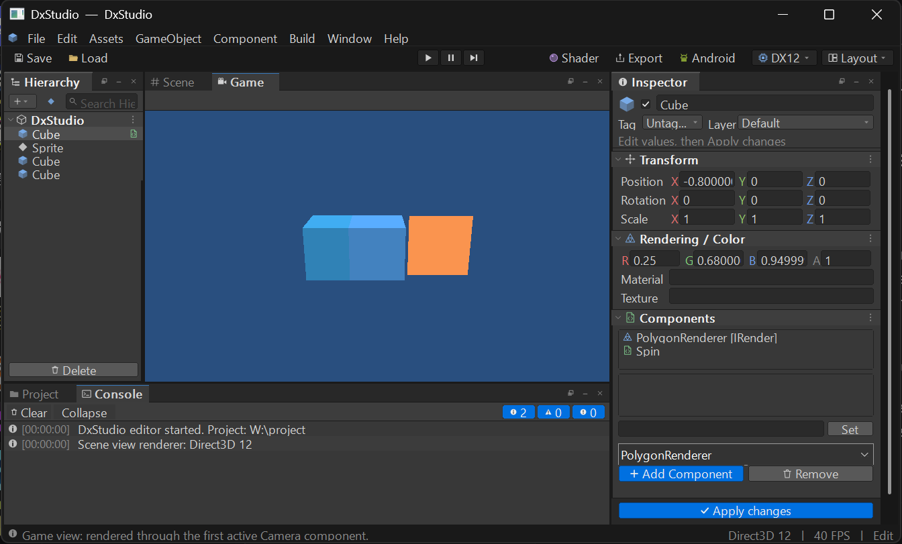
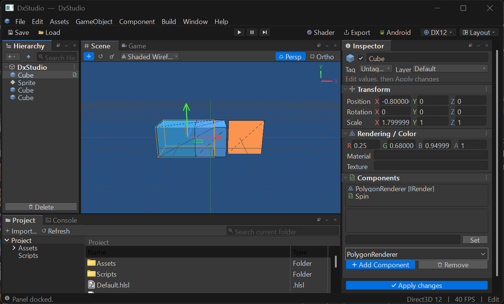
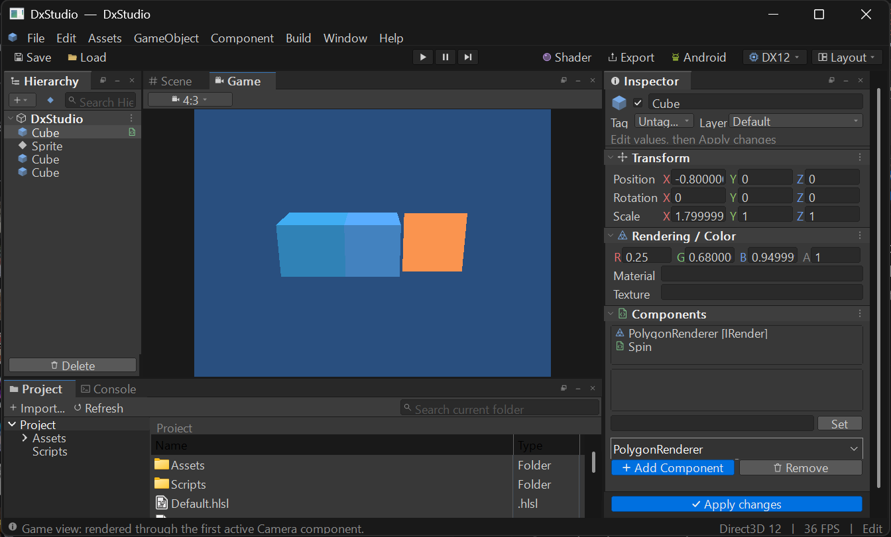

# エディターUIと Unity / Unreal Engine の対応表

DxStudio のエディターUIが、Unity 2022 LTS（Dark スキン）と Unreal Engine 5 のどの要素を再現しているかを記録します。実装場所と、再現していない要素も併記します。

参照した公式資料:
[Unity: Editor インターフェース](https://docs.unity3d.com/2022.3/Documentation/Manual/UsingTheEditor.html)、
[Unity: Toolbar](https://docs.unity3d.com/2022.3/Documentation/Manual/Toolbar.html)、
[Unity: Hierarchy](https://docs.unity3d.com/2022.3/Documentation/Manual/Hierarchy.html)、
[Unity: Inspector](https://docs.unity3d.com/2022.3/Documentation/Manual/UsingTheInspector.html)、
[Unity: Console](https://docs.unity3d.com/2022.3/Documentation/Manual/Console.html)、
[Unity: Game view](https://docs.unity3d.com/2022.3/Documentation/Manual/GameView.html)、
[Unreal Engine 5: Level Editor](https://dev.epicgames.com/documentation/en-us/unreal-engine/level-editor-in-unreal-engine)、
[Unreal Engine 5: Details panel](https://dev.epicgames.com/documentation/en-us/unreal-engine/level-editor-details-panel-in-unreal-engine)

## スクリーンショット

| Scene ビュー（DirectX 12） | Game ビュー + Console | DirectX 9 で起動 |
| --- | --- | --- |
|  |  |  |

| Shaded Wireframe 表示（タブを切り離して戻した後） | Game ビューを 4:3 に固定（上下左右に黒帯） |
| --- | --- |
|  |  |

## 配色（`src/EditorTheme.h`）

| 要素 | Unity 2022 Dark | DxStudio のトークン | 値 |
| --- | --- | --- | --- |
| パネル本体 | #383838 | `COLOR_PANEL` | #383838 |
| ドックのタブ帯 | #282828 | `COLOR_TAB_STRIP` | #282828 |
| 選択中のタブ | #3C3C3C | `COLOR_TAB_ACTIVE` | #3C3C3C |
| メインツールバー / ステータスバー | #191919 | `COLOR_TOOLBAR` | #191919 |
| 入力欄 | #2A2A2A | `COLOR_INPUT` | #2A2A2A |
| ボタン | #585858 | `COLOR_BUTTON` | #585858 |
| 選択行（フォーカスあり / なし） | #2C5D87 / #4D4D4D | `COLOR_SELECTION` / `_INACTIVE` | 同値 |
| コンポーネント見出し | #3E3E3E | `COLOR_HEADER` | #3E3E3E |
| ラベル文字 | #C4C4C4 前後 | `COLOR_TEXT` | #D2D2D2 |
| アクティブツール・Play 中 | （UE5 の青） | `COLOR_ACCENT` | #0070E0 |
| X / Y / Z 軸 | （UE5 の軸色） | `COLOR_AXIS_X/Y/Z` | 赤・緑・青 |

## 要素ごとの対応

| 領域 | Unity / UE の要素 | DxStudio | 実装 |
| --- | --- | --- | --- |
| ウィンドウ | ダークのタイトルバー | DWM のダークモード（Win11 はキャプション色も設定） | `theme::ApplyDarkTitleBar` |
| メニュー | File / Edit / Assets / GameObject / Component / Window / Help | 同じ並び＋Build。ダークのポップアップ、Alt+頭文字 | `EditorChrome.cpp` `CreateMainMenu` |
| メニュー | Component メニュー（登録済みクラスを追加） | 登録済みコンポーネントを列挙し、選択中のオブジェクトに追加 | `ID_ADD_COMPONENT_MENU_FIRST` |
| ツールバー | 中央の Play / Pause / Step | 同じ3ボタン（Play 中は青。Ctrl+P / Ctrl+Shift+P / Ctrl+Alt+P） | `TogglePlay` / `TogglePause` / `StepFrame` |
| ツールバー | Layout ドロップダウン（右端） | Save / Load / Revert Factory Settings | `ShowToolbarDropdown` |
| ツールバー | （UE）RHI の表示 | `DX12 ▾` バッジで DX12 / 11 / 9 を切り替え | `SwitchGraphicsApi` |
| ドック | タブ見出し（アイコン＋名前、フォーカス時に強調）、⋮ メニュー | タブ見出し、フォーカス時の青線、Float / Minimize / Close | `EditorPanels.cpp` `PanelProc` |
| ドック | 下段の Project と Console のタブ | `Project` と `Console` のタブ | `SelectBottomTab` |
| Hierarchy | `+ ▾` 作成ボタンと検索欄 | `+ ▾`、2D 作成、虫眼鏡アイコン付き検索欄 | `LayoutPanel(0)` |
| Hierarchy | シーン名の行 | シーン名の行（▼・アイコン・⋮） | `PanelProc` |
| Hierarchy | 折りたたみ式ツリー、種類別アイコン、非アクティブは灰色 | ▼/▶ の折りたたみ、Cube / Quad / Camera / Model / Empty のアイコン、灰色表示 | `DrawHierarchyRow` |
| Hierarchy | ホバー強調、ドロップ先の表示 | ホバー時の背景、ドラッグ中のドロップ先を青枠 | `hierarchyHot` |
| Scene | ツールのオーバーレイ（Move / Rotate / Scale） | アイコンのツール切り替え（W / E / R） | `gizmoButtons` |
| Scene | 向きギズモ（右上の X / Y / Z） | 右上に X / Y / Z 軸と文字を描画（奥向きの軸は暗く） | `Renderer.cpp` 手順7 |
| Scene / Game | `Scene` と `Game` のタブ。Play で Game に移る | 同じ動作。Game ではオーバーレイなし、カメラ操作なし | `SelectViewTab` |
| Scene | 描画モードの切り替え（Shaded / Wireframe / Shaded Wireframe） | 同じ3モード。DX12 / 11 / 9 の各バックエンドにワイヤーフレーム用のパイプラインを追加 | `SetDrawMode` / `PipelineKind::SCENE_WIREFRAME` |
| Game | 縦横比の指定（Free Aspect / 16:9 / 16:10 / 4:3 / 1:1） | 同じ選択肢。周囲に黒帯を付けて縦横比を固定 | `SetGameAspect` |
| Inspector | 数値ラベルのドラッグで値を変える | X / Y / Z / R / G / B / A のラベルを左右にドラッグ（Shift で10倍、Alt で0.1倍） | `LabelDragSubclassProc` |
| ドック | タブを引き出して分離、戻して再ドッキング | タブ見出しをドラッグするとフローティングになり、そのまま移動。エディターの上で離すと元の位置に戻る（Ctrl を押しながら離すとフローティングのまま） | `PanelProc` の `WM_MOUSEMOVE` / `WM_EXITSIZEMOVE` |
| Inspector | アイコン、有効チェック、名前、Tag / Layer の欄 | 同じ並び（チェックボックスは自前描画） | `DrawInspectorStatic` |
| Inspector | コンポーネント見出し（▼、アイコン、太字、⋮） | `ButtonRole::HEADER` | `theme::DrawButton` |
| Inspector | （UE）X / Y / Z 入力欄の色付きバー | 各入力欄の左に軸色のバー | `PanelProc`（index 2） |
| Inspector | プロパティ行（ラベルと値の欄） | コンポーネント値を「名前＋入力欄」の行で表示。bool はチェック | `DrawFieldRow` |
| Inspector | 青い `Add Component` ボタン | 青い Primary ボタン＋固定フッターの `Apply changes` | `ButtonRole::PRIMARY` |
| Project | 左にフォルダーツリー、右に内容、上に検索欄 | 同じ構成（ダークのツリー / リスト / ヘッダー） | `ProjectPanel.cpp` |
| Console | Clear / Collapse、レベル別の件数フィルター、時刻、コピー | 同じ機能、Ctrl+C でコピー、Ctrl+Shift+C で表示 | `ConsolePanel.cpp` |
| ステータスバー | 最後のメッセージ | 最後のメッセージ＋API・FPS・Play 状態 | `UpdateFrameStats` |
| 共通 | ツールチップ | アイコンボタンにショートカット付きのツールチップ | `AddTooltip` |

## 再現していない要素と理由

| 要素 | 理由 |
| --- | --- |
| Unity / UE のアイコン画像そのもの | 商標と著作物のため使わず、同じ意味の図形を GDI+ でアンチエイリアス描画しています（`theme::DrawIcon`）。 |
| 任意の位置に挿入するドッキング（分割位置のプレビュー表示） | 再ドッキングは元の位置に戻る方式です。既存の固定4領域とレイアウト保存の形式（`EditorLayout.dxl`）を変えないためです。 |

## 命名規則（cpp_TKG `NAMING_RULES.md`）の適用範囲

- 新しく書いたコード（`src/Core`、`src/Graphics`、`EditorTheme`、`ConsolePanel`、テスト、`PulseController`）は規則どおりです。メンバーは `m_` 接頭辞、変数は `n` / `f` / `b` / `p` / `v` / `s` / `d` / `a` / `u` の型接頭辞、`constexpr` と列挙子は UPPER_CASE、関数は PascalCase です。
- 既存のコマンドID `kXxx` は、`constexpr` 定数の規則に合わせて `ID_XXX` に改名しました。
- 規則の「既存の違反を一括修正せず、新規・変更箇所から適用する」に従い、次のものは名前を変えていません。
  - ユーザーのスクリプトから使われる公開API: `Entity::draw`、`DrawItem::position`、`Component::Update(Entity&, float deltaSeconds)`、`Scene::entities` など。変えると既存のプロジェクトのスクリプトがコンパイルできなくなります。
- `Editor` 構造体（エディター内部の状態）の数値・フラグ・コンテナのフィールドは、規則の型接頭辞に揃えました（401箇所）。例: `selected` → `nSelected`、`playing` → `bPlaying`、`selectedIndices` → `vSelectedIndices`、`dockLeft` → `nDockLeft`、`sectionOpen` → `aSectionOpen`。struct の公開フィールドなので `m_` は付けていません（規則どおり）。
