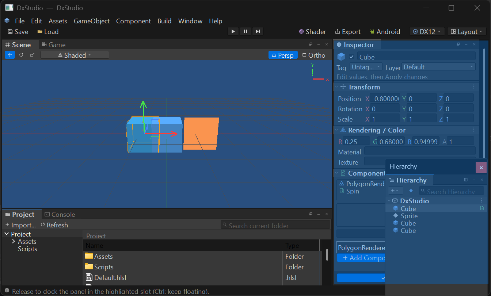
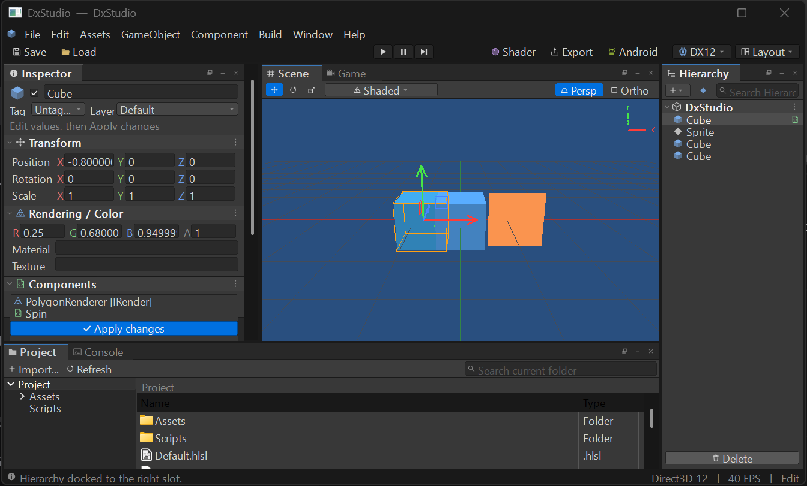
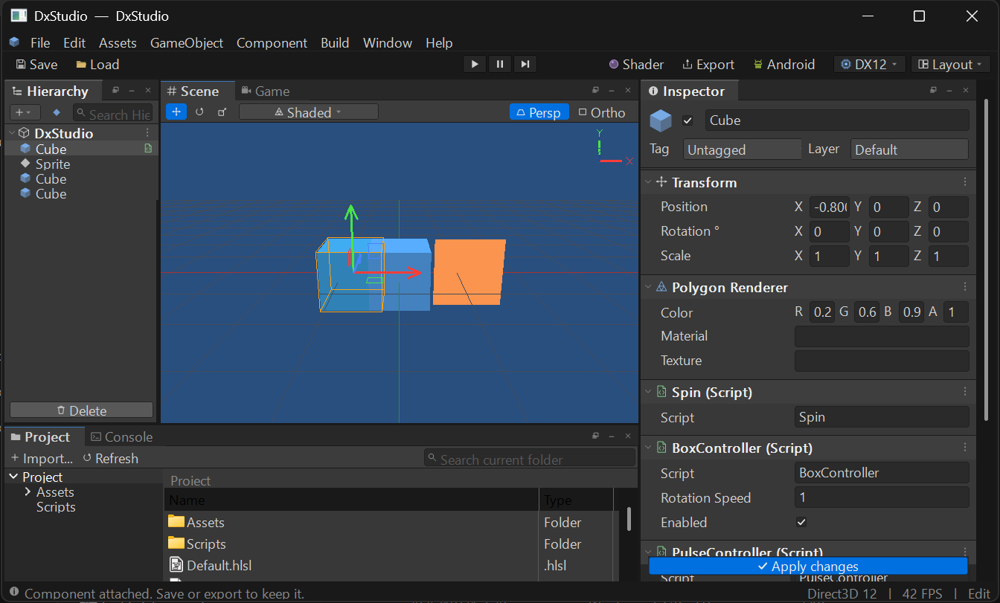

# エディターUIと Unity / Unreal Engine の対応表

DxStudio のエディターUIが、Unity 2022 LTS（Dark スキン）と Unreal Engine 5 のどの要素を再現しているかを記録します。実装場所と、再現していない要素も併記します。

参照した公式資料:
[Unity: Editor インターフェース](https://docs.unity3d.com/2022.3/Documentation/Manual/UsingTheEditor.html)、
[Unity: Toolbar](https://docs.unity3d.com/2022.3/Documentation/Manual/Toolbar.html)、
[Unity: Hierarchy](https://docs.unity3d.com/2022.3/Documentation/Manual/Hierarchy.html)、
[Unity: Inspector](https://docs.unity3d.com/2022.3/Documentation/Manual/UsingTheInspector.html)、
[Unity: Console](https://docs.unity3d.com/2022.3/Documentation/Manual/Console.html)、
[Unity: Game view](https://docs.unity3d.com/2022.3/Documentation/Manual/GameView.html)、
[Unreal Engine 5: Level Editor](https://dev.epicgames.com/documentation/en-us/unreal-engine/level-editor-in-unreal-engine)、
[Unreal Engine 5: Details panel](https://dev.epicgames.com/documentation/en-us/unreal-engine/level-editor-details-panel-in-unreal-engine)

## スクリーンショット

| Scene ビュー（DirectX 12） | Game ビュー + Console | DirectX 9 で起動 |
| --- | --- | --- |
|  |  |  |

| Shaded Wireframe 表示（タブを切り離して戻した後） | Game ビューを 4:3 に固定（上下左右に黒帯） |
| --- | --- |
|  |  |

| ドッキングのプレビュー（Hierarchy を右へドラッグ中） | ドロップ後（Hierarchy と Inspector が入れ替わる） |
| --- | --- |
|  |  |

| Inspector（Unity と同じ寸法・構成。コンポーネントごとのセクション） |
| --- |
|  |

## 配色（`src/EditorTheme.h`）

| 要素 | Unity 2022 Dark | DxStudio のトークン | 値 |
| --- | --- | --- | --- |
| パネル本体 | #383838 | `COLOR_PANEL` | #383838 |
| ドックのタブ帯 | #282828 | `COLOR_TAB_STRIP` | #282828 |
| 選択中のタブ | #3C3C3C | `COLOR_TAB_ACTIVE` | #3C3C3C |
| メインツールバー / ステータスバー | #191919 | `COLOR_TOOLBAR` | #191919 |
| 入力欄 | #2A2A2A | `COLOR_INPUT` | #2A2A2A |
| ボタン | #585858 | `COLOR_BUTTON` | #585858 |
| 選択行（フォーカスあり / なし） | #2C5D87 / #4D4D4D | `COLOR_SELECTION` / `_INACTIVE` | 同値 |
| コンポーネント見出し | #3E3E3E | `COLOR_HEADER` | #3E3E3E |
| ラベル文字 | #C4C4C4 前後 | `COLOR_TEXT` | #D2D2D2 |
| アクティブツール・Play 中 | （UE5 の青） | `COLOR_ACCENT` | #0070E0 |
| X / Y / Z 軸 | （UE5 の軸色） | `COLOR_AXIS_X/Y/Z` | 赤・緑・青 |

## 要素ごとの対応

| 領域 | Unity / UE の要素 | DxStudio | 実装 |
| --- | --- | --- | --- |
| ウィンドウ | ダークのタイトルバー | DWM のダークモード（Win11 はキャプション色も設定） | `theme::ApplyDarkTitleBar` |
| メニュー | File / Edit / Assets / GameObject / Component / Window / Help | 同じ並び＋Build。ダークのポップアップ、Alt+頭文字 | `EditorChrome.cpp` `CreateMainMenu` |
| メニュー | Component メニュー（登録済みクラスを追加） | 登録済みコンポーネントを列挙し、選択中のオブジェクトに追加 | `ID_ADD_COMPONENT_MENU_FIRST` |
| ツールバー | 中央の Play / Pause / Step | 同じ3ボタン（Play 中は青。Ctrl+P / Ctrl+Shift+P / Ctrl+Alt+P） | `TogglePlay` / `TogglePause` / `StepFrame` |
| ツールバー | Layout ドロップダウン（右端） | Save / Load / Revert Factory Settings | `ShowToolbarDropdown` |
| ツールバー | （UE）RHI の表示 | `DX12 ▾` バッジで DX12 / 11 / 9 を切り替え | `SwitchGraphicsApi` |
| ドック | タブ見出し（アイコン＋名前、フォーカス時に強調）、⋮ メニュー | タブ見出し、フォーカス時の青線、Float / Minimize / Close | `EditorPanels.cpp` `PanelProc` |
| ドック | 下段の Project と Console のタブ | `Project` と `Console` のタブ | `SelectBottomTab` |
| Hierarchy | `+ ▾` 作成ボタンと検索欄 | `+ ▾`、2D 作成、虫眼鏡アイコン付き検索欄 | `LayoutPanel(0)` |
| Hierarchy | シーン名の行 | シーン名の行（▼・アイコン・⋮） | `PanelProc` |
| Hierarchy | 折りたたみ式ツリー、種類別アイコン、非アクティブは灰色 | ▼/▶ の折りたたみ、Cube / Quad / Camera / Model / Empty のアイコン、灰色表示 | `DrawHierarchyRow` |
| Hierarchy | ホバー強調、ドロップ先の表示 | ホバー時の背景、ドラッグ中のドロップ先を青枠 | `hierarchyHot` |
| Scene | ツールのオーバーレイ（Move / Rotate / Scale） | アイコンのツール切り替え（W / E / R） | `gizmoButtons` |
| Scene | 向きギズモ（右上の X / Y / Z） | 右上に X / Y / Z 軸と文字を描画（奥向きの軸は暗く） | `Renderer.cpp` 手順7 |
| Scene / Game | `Scene` と `Game` のタブ。Play で Game に移る | 同じ動作。Game ではオーバーレイなし、カメラ操作なし | `SelectViewTab` |
| Scene | 描画モードの切り替え（Shaded / Wireframe / Shaded Wireframe） | 同じ3モード。DX12 / 11 / 9 の各バックエンドにワイヤーフレーム用のパイプラインを追加 | `SetDrawMode` / `PipelineKind::SCENE_WIREFRAME` |
| Game | 縦横比の指定（Free Aspect / 16:9 / 16:10 / 4:3 / 1:1） | 同じ選択肢。周囲に黒帯を付けて縦横比を固定 | `SetGameAspect` |
| Inspector | 数値ラベルのドラッグで値を変える | X / Y / Z / R / G / B / A のラベルを左右にドラッグ（Shift で10倍、Alt で0.1倍） | `LabelDragSubclassProc` |
| ドック | タブを引き出して分離、ドロップ位置のプレビュー付きで再ドッキング | タブ見出しをドラッグするとフローティングになり、そのまま移動。エディターの上では、ドロップ先の領域（左・中央・右・下）が青く表示される。離すとその領域に入り、元の領域にあったパネルと入れ替わる（Ctrl を押しながら離すとフローティングのまま）。左右の入れ替えでは列の幅も入れ替わり、配置は `EditorLayout.dxl`（バージョン2。バージョン1も読み込み可）に保存される | `DockSlotAt` / `ShowDockPreview` / `DockPanelInSlot` |
| Inspector | GameObject ヘッダー（アイコン 24px、有効チェック、名前）と Tag / Layer の行 | 同じ並びと寸法 | `LayoutPanel(2)` / `DrawInspectorStatic` |
| Inspector | コンポーネントごとのタイトルバー（▼、アイコン、太字、右端の ⋮） | Transform、レンダラー（Polygon Renderer など）、スクリプト（`Spin (Script)` など）の各コンポーネントが独立したセクション。▼で折りたたみ、⋮と右クリックでメニュー（Remove Component / Move Up / Move Down、Transform は Reset） | `RebuildComponentViews` / `ShowTitlebarMenu` |
| Inspector | ラベル列と値の列（ラベル幅 = max(幅×0.45−40, 120)）、行の高さ 20・間隔 2・インデント 15+3 | UnityCsReference の `EditorGUI.cs` と同じ値を DPI に合わせて拡大 | `LayoutPanel(2)` |
| Inspector | Vector3 欄（X / Y / Z の小ラベル＋3つの入力欄、間隔 4） | Position / Rotation / Scale、Color の R / G / B / A が同じ形式 | `multiField` |
| Inspector | スクリプトの読み取り専用 `Script` 欄とプロパティ行 | `Script` 欄＋ `EditorFields()` の各フィールド。bool はチェックボックス、float / int / string は入力欄。Enter かフォーカス移動で適用し、Play 中は実行中の値が表示される | `CommitComponentField` |
| Inspector | 登録されていないスクリプトの警告 | 「The associated script can not be loaded.」を警告色で表示 | `RebuildComponentViews` |
| Inspector | 中央の `Add Component` ボタン（幅230×高さ25） | 同じ寸法。押すと Rendering / Scripts に分かれた一覧が開き、追加済みのものは選べない | `ShowAddComponentMenu` |
| Project | 左にフォルダーツリー、右に内容、上に検索欄 | 同じ構成（ダークのツリー / リスト / ヘッダー） | `ProjectPanel.cpp` |
| Console | Clear / Collapse、レベル別の件数フィルター、時刻、コピー | 同じ機能、Ctrl+C でコピー、Ctrl+Shift+C で表示 | `ConsolePanel.cpp` |
| ステータスバー | 最後のメッセージ | 最後のメッセージ＋API・FPS・Play 状態 | `UpdateFrameStats` |
| 共通 | ツールチップ | アイコンボタンにショートカット付きのツールチップ | `AddTooltip` |

## 再現していない要素と理由

| 要素 | 理由 |
| --- | --- |
| Unity / UE のアイコン画像そのもの | 商標と著作物のため使わず、同じ意味の図形を GDI+ でアンチエイリアス描画しています（`theme::DrawIcon`）。 |
| 1つの領域を分割して2つ以上のパネルを並べるドッキング | ドッキング先は4つの領域（左・中央・右・下）で、パネル同士を入れ替える方式です。既存の4パネル構成とスプリッターの操作を変えないためです。 |

## 命名規則（cpp_TKG `NAMING_RULES.md`）の適用範囲

- 新しく書いたコード（`src/Core`、`src/Graphics`、`EditorTheme`、`ConsolePanel`、テスト、`PulseController`）は規則どおりです。メンバーは `m_` 接頭辞、変数は `n` / `f` / `b` / `p` / `v` / `s` / `d` / `a` / `u` の型接頭辞、`constexpr` と列挙子は UPPER_CASE、関数は PascalCase です。
- 既存のコマンドID `kXxx` は、`constexpr` 定数の規則に合わせて `ID_XXX` に改名しました。
- 公開APIのフィールドも規則に揃えました（581箇所）。struct の公開フィールドなので `m_` は付けず、型接頭辞だけを付けています。class / struct 型のオブジェクト（`draw`、`position`、`camera` など）は規則どおり接頭辞なしのままです。

  | 型 | 旧名 → 新名 |
  | --- | --- |
  | `Entity` | `name` → `sName`、`parent` → `nParent`、`components` → `vComponents`、`modelAsset` → `sModelAsset`、`materialAsset` → `sMaterialAsset`、`textureAsset` → `sTextureAsset`、`playAnimation` → `bPlayAnimation`、`animationTime` → `fAnimationTime`、`animationIndex` → `nAnimationIndex`、`runtimeComponents` → `vRuntimeComponents` など |
  | `DrawItem` | `is2D` → `bIs2D`、`visible` → `bVisible`、`vertices` → `pVertices` |
  | `Camera` | `yaw` → `fYaw`、`pitch` → `fPitch`、`distance` → `fDistance`、`orthographic` → `bOrthographic`、`fieldOfView` → `fFieldOfView`、`nearClip` → `fNearClip`、`farClip` → `fFarClip` |
  | `Scene` | `entities` → `vEntities` |
  | `Material` / `EditorField` | `name` → `sName`、`textureAsset` → `sTextureAsset`、`shaderAsset` → `sShaderAsset`、`value` → `pValue`、`readOnly` → `bReadOnly` |
  | `CameraComponent` などのクラス | `active` → `m_bActive`、`fieldOfView` → `m_fFieldOfView` など（クラスのフィールドなので `m_`） |
  | `Component::Update` | 引数 `deltaSeconds` → `fDeltaSeconds` |

  Inspector の表示名（`EditField("Rotation Speed", ...)`）は変えていないので、保存済みのシーン（`scene.dxs`）はそのまま読み込めます。ユーザーのスクリプトは新しい名前に合わせる必要があります（同梱のサンプルは変更済み）。
- 名前の対象外: `HWND` / `HMENU` / `HDC` などの Win32 ハンドルは規則の表にないため、Windows の慣例どおり `h` 接頭辞を使っています。
- `Editor` 構造体（エディター内部の状態）の数値・フラグ・コンテナのフィールドは、規則の型接頭辞に揃えました（401箇所）。例: `selected` → `nSelected`、`playing` → `bPlaying`、`selectedIndices` → `vSelectedIndices`、`dockLeft` → `nDockLeft`、`sectionOpen` → `aSectionOpen`。struct の公開フィールドなので `m_` は付けていません（規則どおり）。
